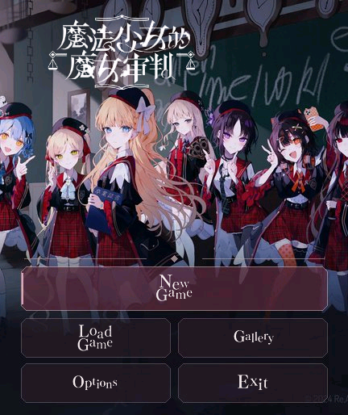

# 《魔法少女的魔女审判》· 红米手表 5

将使用者提供的 Steam 原版《魔法少女的魔女审判》转换为 Vela 原生图文应用，目标设备为 **REDMI Watch 5，432 × 514**。当前版本为 **0.1.7**，安装包约 **9.98 MB**，构建时限制为 10,000,000 字节。

本项目的资源分析、转换器、手表运行时代码、界面和自动检查由 **Codex** 完成；设备持有者负责需求反馈与实机验证。**2026-10-25，维护者确认 0.1.7 在红米手表 5 实机测试通过，暂未发现 bug。** 该反馈不代表已经穷尽全部路线或固件环境，具体见 `reports/physical-test-v017.json`。

## 下载与预览

[下载 v0.1.7 安装包、源码和校验文件](https://github.com/xuanyide01/manosaba-rw5/releases/tag/v0.1.7)。BIN 与 RPK 内容相同；通过“表盘自定义工具”安装 BIN，手机传输完成后仍需等待手表端完成安装。

 

标题截图来自当前 0.1.7 安装包在官方 Vela 432×514 模拟器的实际画面。

## 0.1.7 图标取景调整

应用图标改为宽取景，保留原封套中完整可见的人物和栅栏，并留出圆形边缘安全区，避免裁切头部或衣服；不再只显示脸部。原插画本身仅画到封套可见范围，没有补画画外身体。图标仍为 192×192 透明圆形 RGBA PNG，裁切范围见 `reports/icon-v017.json`。

本次只更新图标和版本号，游戏代码、剧情、字体、CG／立绘及存档格式与 0.1.6 一致。检查范围为取景预览、PNG 解码、安装包签名、包体和资源差异；游戏功能的自动验证沿用代码相同的 0.1.6；0.1.7 另完成模拟器安装和标题截图，维护者随后确认实机测试通过。

## 0.1.6 调查、反驳与离线资源整理

- 调查地点按“未调查在前、已调查在后”显示，各组保留原作顺序。仍使用原地点 ID 与标记位，存档中的访问记录不变；已调查地点仍可再次进入。
- 阅读底栏为“上一句／菜单／魔女手册／下一句”，调查、选项页底部为左侧菜单、右侧魔女手册，并加大触控区域。
- 审判直接显示原文可反驳词语，点击即进入该词对应的原作分支。例如“用血画下”“用手上的笔”，以及同句中的“诺亚／死前／凶手”，各自保留原脚本标签。
- 词语按钮高 52—84 px、文字 20—22 px，长词自动分行。出现反驳词时适当缩小上方画面，为正文与按钮留出空间；立绘底部与文本框相接，正文仍可滚动。
- 458 块剧情的连续文本索引、13 个调查停点的访问状态顺序表、467 处反驳词和布局，以及全部立绘位置由电脑端生成。手表读取带 `ops` 与 `plan` 的程序块和 `portrait-layouts.txt`，不再建立文本索引、排序调查地点或计算立绘缩放比例；动态剧情变量、可见对象筛选和交互仍需实时处理。
- 应用列表圆形图标使用用户指定的同款原声带插画。找到的是高清封套扫描件，从未被文字／栅栏遮挡的脸部区域直接裁切；尚未找到整张独立无栅栏、无字原稿。192×192、透明圆形、RGBA PNG，来源与裁切范围见 `reports/icon-v016.json`。

58 项回归测试通过。全部原始 90,243 条指令的顺序和位置保留；预处理数据放在指令数组之外，兼容原有 30 个存档。904 个剧情状态已与旧版对照；地图按原地点 ID 归一比较，排除本次刻意调整的显示顺序。

0.1.6 原生 Vela 模拟器已验证实际访问后地点后置、左右按键、单词／三词反驳、最长词语完整显示、原作提问与返回发言，以及旧存档读取。应用列表图标已校验透明圆形和 8-bit RGBA 编码；通用模拟器无原机应用桌面，图标实际显示及整版游戏仍需红米手表 5 复测。

## 0.1.5 运行结构与跳章优化

参考《命运石之门》移植项目的目录／剧情分块分离和跳转索引结构，将常用系统例程集中在 `runtime-helpers.txt`，启动时读取一次；普通剧情保留原有分块文件。分块只缓存最近两块，源码字符总量上限为 65,536 个 UTF-16 代码单元，返回标题或退出时清空，不缓存整部游戏。

0.1.5 在每块载入时建立连续纯文本段索引；0.1.6 已移到电脑端构建。跳章会直接跨过没有选项、反驳或附加动作的连续对白，保留中间的变量、证据、进退场和动态条件执行；缓存命中的系统调用／返回在限定的单轮执行预算内连续完成，减少异步文件往返和事件循环等待。

**跳章保留自动模式开关和速度：**

- 原本关闭的仍关闭。
- 原本开启的到普通章节后，按原速度完成文字显示、等待并继续。
- 选项、调查、证据提交、反驳等待玩家操作，处理后自动继续。
- 跳到审判开场或原作明确要求点击继续的位置时，开关仍显示“开”，先停候操作；手动点击下一句或在菜单选择“返回游戏”后继续自动。
- 返回标题、剧情结束、报错或点击上一句仍按既有规则关闭自动播放；每次启动默认关闭，只保存速度。

53 项回归测试通过，覆盖缓存上限、异步取消、自动开关和所有重要停点；904 个原作剧情状态（含 371 个入口及选项／反驳后的分支）与 0.1.4 对照，停止位置、完整 VM 状态、自动保存载荷和选项均一致。原有剧情指令位置及 30 个存档键保持不变。

本次官方 Vela 模拟器同环境单次对照：开场至首个选项 1,435 → 1,120 ms，审判开场 668 → 669 ms，审判开场至反驳 451 → 349 ms，真正下一章入口 450 → 346 ms。计时范围为点击跳章到选中停点，不包含后续逐字显示；单次测量受主机负载影响，不作为实机耗时保证。详见 `reports/performance-v015.json`。

原生模拟器已验证开关保持、选择后自动继续、审判开场停候、反驳拦截、普通章节自动继续和旧版存档读取。0.1.5 仍需实机确认。

## 0.1.4 跳章修复

“下一章”现在按原作的幕／章分界运行，不再把每个日常小节文件当成章节。日常 1、2、3 等小节会连续跳过，直到下列最先到达的位置：

- 下一章或下一幕的第一句；
- 审判开场的第一句；
- 普通选项、地图调查、证据提交、处刑确认或反驳关键词；
- 原作要求点击继续的明确暂停处，或剧情结束。

跳转执行原作中间的变量、证据、立绘和背景更新，不直接改成章节目录的目标地址，也不会替玩家选择答案。已显示的选项／反驳列表保持原位。0.1.4 在手动跳章后关闭自动播放；0.1.5 按反馈改为保留开关，规则见上节。

保留原有 30 个存档栏位、存储键和剧情指令位置。44 项回归测试通过；371 个段落入口均完成跳章停点检查，详见 `reports/chapter-skip-v014.json`。

0.1.4 原生 Vela 模拟器已验证从开场跨过多个日常小节抵达首个选项、日常转审判开场、审判中反驳关键词拦截、保留当前选项／关键词列表、第一章末尾跳到第二章首句及旧版存档读取。跳章结束后保持停留，不继续自动推进；新版本仍需实机确认。

## 0.1.3 更新

- 标题采用用户选定的 C 方案：官方校园群像插画。New Game 使用独立主按钮，下方 Load Game／Gallery、Options／Exit 各占一行；保留原作按钮字样，配合暗玫瑰色半透明切角边框。
- 保留原作 `g_gameProgress < 6` 的切换分界：第一幕结束后改用同幅群像的另一取景；已解锁进度持续保存。
- 自动播放只对后续句子按约 30 毫秒一字显示。开启时当前已显示完整的句子直接开始等待；慢／标准／快分别等待 2.6／1.5／0.8 秒，超过 60 字另加每字 30 毫秒，额外等待最多 5 秒。手动显示速度保持独立。
- 按住或滑动正文时暂停自动推进，松手且惯性滚动停止后重新计时；菜单、手册、存读档及后台均不推进。遇交互停点等待玩家，选完继续。每次启动默认关闭，只保留速度档位。
- 保留 30 个旧存档栏位、存储键和数据结构。

## 0.1.2 修复

- 选项按各自原作停点重建，重复进入、返回发言和读取存档不消耗选项；每次打开列表重新生成控件键，并拒绝旧列表遗留的点击事件。保留原脚本的讨论推进、追问和证据条件，不统一修改这些变量。
- 补回紫藤亚里沙的口罩：只过滤引擎剪裁蒙版，保留原作可见的口罩图层。
- 典狱长按原作的 1—13 号图片切换，不再统一显示默认图。
- 调整远野汉娜的取景，改善双人画面中过小的问题，并保持立绘底部与文本框相接。
- 区分中景、前景、回忆等角色实例，处理对应退场、移出画面和背景／CG 覆盖层，修复旧角色残留。仍采用静态画面，移动动画只取最终位置。
- 90,243 条剧情指令的顺序和跳转位置保持不变，兼容旧存档位置。旧档若已记录了错误的可见角色状态，可从当前章节重新进入重建画面；不清除保存栏位。

## 已实现

- 中文剧情、原作中文人物名、静态背景和 CG、透明角色立绘。CG 保留完整构图，在画面上方按比例显示；对白在下方自动换行，可滑动，重新轻点仍可继续。
- 保留原脚本中的普通选择、错误答案剧情、地图调查标记、证据版本、证据提交和审判反驳标签。反驳时点击人物姓名右侧的“反驳”，再选择发言关键词及后续选项。
- 底部工具栏的“魔女手册”可查看当前已取得的证据、人物、规则和笔记，含证据图片；普通选择页面也可直接打开手册。
- **30 个独立保存／读取栏位**，手动选择读取，覆盖前确认；保存剧情位置、变量、证据版本和返回栈。
- 两幕共 11 个章节分组，371 个日常／审判段落入口；第一页切换使用独立键，避免旧列表内容残留。
- 菜单中的“下一章”跨过日常小节，抵达原作下一幕／章的开头；途中遇审判开场、普通选项、调查、证据提交、处刑确认或反驳关键词即停止，不自动代选。
- CG 鉴赏共 61 组、172 张，差分归组，打开后点击切换。
- 全屏校园群像标题，随原作第一幕／第二幕进度切换取景；原作 New Game、Load Game、Gallery、Options、Exit 字样从原始按钮图片提取，章节选择位于 Gallery 页右上角。
- 阅读界面去除幕／章／日常等场景标识，保留姓名和必要的反驳入口。
- 全部立绘改为 256 色感知调色 PNG，改善橘雪莉等角色的肤色和衣服色块；保持原有图层组合、透明边缘及底部对齐。
- 菜单增加自动播放及慢／标准／快三档速度，按约 30 毫秒一字显示，完成后等待 2.6／1.5／0.8 秒；超过 60 字的段落另加阅读时间，额外最多 5 秒。
- 圆形透明图标、标题页退出应用、24／28 字号和即时／逐字显示设置。
- 独立包名 `com.codex.manosaba.rw5`，独立存档键，不与此前游戏共用。

## 适配范围

这是按原作剧本制作的 **静态图文适配**，没有在手表上运行 Unity 或 Windows 程序。为了控制包体和运行开销，不包含语音、音乐、视频、3D 审判镜头、实时表情动画及完整的事件重演动画。立绘使用从原作图层组合导出的主要表情，手臂动作和细小表情没有逐一复现；部分魔女状态使用静态图。

原作的调查和审判操作改为触控列表；保留命题／证据／目标标签对应关系。手表版不运行实时审判倒计时，错误答案仍进入原作对应剧情，并采用 10 点容错计数；该计数不是对原作难度数值的还原。计数耗尽后可读取此前保存栏位。处刑按钮和片尾异步回调改为明确的确认／继续操作。

自动检查确认了原脚本的跳转结构和可通关路径，不能代替逐句人工校对或整部作品的实机游玩。原作更新后，转换结果需要重新验证。

## 安装和操作

1. 使用支持该设备的“表盘自定义工具”选择 `.bin` 文件，经蓝牙上传。
2. 手机传输完成后，**继续等待手表完成安装**，不要立刻重新发送；上传完成不等于安装完成。
3. 进入应用后选择 New Game，也可进入 Gallery，再点右上角“章节选择”开始指定段落。
4. 阅读中点文本或“下一句”推进；滑动文本只滚动，不会自动进入下一句。底部直接打开手册，菜单可保存、读取、设置自动播放或返回标题。
5. 审判发言有可反驳关键词时，直接显示原文词语按钮；点击对应词语进入原作分支，再选择命题或提交证据。证据详情可从右侧底栏进入魔女手册查看。
6. 阅读菜单打开“自动播放”，点“返回游戏”继续；“自动速度”循环切换三档。遇普通选项、调查地点、提交证据、处刑确认和反驳关键词时停止等待玩家，不自动代选；处理后继续播放。
7. 打开菜单、手册、保存／读取页、滑动正文或切到后台会暂停计时。返回正文或结束滑动后重新等待；滑动后重新轻点仍可下一句。点“上一句”关闭自动播放，返回标题、结束或报错也会关闭。速度保存到本地，每次启动默认关闭自动播放。

### 异常处理

- 如出现卡住或闪退，先返回系统桌面，再重新打开并读取较早的保存栏位。应用无响应时，按设备原有方式重启手表。
- 如手机传输结束后没有图标，先等待安装；仍不成功时重启手表和工具，再安装一次。卸载会清除本应用存档。
- 若连此前已验证的其他应用也无法安装，可能是系统安装服务异常。此前项目中曾有重置系统后恢复的实例；**恢复出厂会清除设备数据，仅作为备份后的最后手段**，不应作为日常安装步骤。
- 本应用不修改固件、系统分区或设备引导程序。模拟器通过不等于所有固件均兼容，不保证不会闪退。

## 转换与验证

原始资源在本机 `G:\SteamLibrary\steamapps\common\manosaba_game`，原文件只读。使用 UnityPy 提取 Addressables 中的剧本、简体中文本地化、CG、角色图层和资料数据；不加载 `GameAssembly.dll` 或运行原版程序。

`tools/convert-story.py` 读取相邻 `manosaba-probe` 的静态提取数据，将 Naninovel 命令编译为分块 JSON。条件表达式由有限语法解析器处理，不使用 `eval`；未知语义命令和未解析标签会让转换失败。运行时每次读取最多 512 条指令，逐步执行并在交互点暂停。构建前由 `tools/prepare-runtime.cjs` 将两个共享系统例程的三块指令集中为一个运行目录；此步骤只读取交付源码中的已转换剧情，无需再次提取原作。连续文本索引在电脑端生成，`src/common/program-store.js` 只负责验证、打开预处理块和维护两块 LRU 缓存。

构建安装包无需原作提取目录：交付源码已含转换后的 `src/common`。需要 Node.js 和兼容编译器：

```powershell
npm install --prefix tools/compat-toolkit --ignore-scripts
node tools/build.cjs
node --test tests/runtime.cjs tests/autoplay.cjs tests/fixes-v012.cjs tests/chapter-skip.cjs tests/program-store.cjs tests/ui-v016.cjs
```

Python 包体校验需要 Pillow、fontTools、cryptography：

```powershell
python tools/audit-package.py
node tools/audit-scenarios.cjs
node tools/audit-scenarios.cjs --continuous
node tools/audit-all-choices.cjs
node tools/audit-optimized-runtime.cjs
node tools/audit-chapter-skip.cjs
```

检查报告保存在 `reports/`，包括 424 个剧本的静态控制流、分段探索、从开场到最终结局的连续自动路径、字体覆盖、图像解码、双层签名及文件哈希。本版 58 项回归测试通过，覆盖自动播放、返回／错误答案后的选项恢复、旧状态缓存缺失、剧情门槛、角色实例和退场、典狱长造型、汉娜大小、Gallery 导航等。

全量静态检查覆盖 691 个选择停点及原作 1,522 条 AddChoice；含一处复用菜单停点，最终停点定义共引用 1,525 项，均非空且跳转有效。166 段审判的有界分支探索访问 123,896 个状态、执行 16,388 次选择现场读档／重建比较，未出现空选项或执行错误；每段最多探索 2,000 个分支节点，37 段达到上限，因此不声称穷尽所有排列。371 个日常／审判入口均找到可继续路径，保留状态的连续自动路径经过 417 段后抵达最终结局。

本次 0.1.3 原生模拟器检查已验证五个新标题按钮、旧版栏位读取、自动推进、正文滑动后恢复、选项暂停与选择后继续、菜单暂停、上一句关闭自动、CG 差分及退出重开。剧情分块、正常阅读控制流、存档结构、立绘资源映射和布局保持不变；0.1.4 仅调整跳章运行及其菜单操作。此前 0.1.3 与 0.1.2 交付源码的逐字节比对见旧记录；全量剧情／分支报告沿用该不变部分的检查结果，见 `reports/v013-baseline-compatibility.json`。

原生模拟器测试使用独立的官方 Vela 虚拟设备，不能模拟红米手表 5 的实际固件和蓝牙安装链路。

图像预算：背景／CG 最宽 360 像素、JPEG 质量 52，手册插图最宽 300 像素、JPEG 质量 52；立绘上半身适当裁剪，最大 240 × 300，使用 libimagequant 的 256 色感知调色透明 PNG；相同表情去重。重新生成图像需要 Pillow、UnityPy 和 imagequant==1.1.5 以及本地已提取的原作素材。PNG 另经 pyoxipng 9.1.1 无损优化，逐文件核对解码后的 RGBA 像素与位深不变；运行 `python tools/optimize-png.py` 后再构建。可用 `python -m pip install --target tools/image-deps pyoxipng==9.1.1` 安装该可选构建依赖。标题可通过 `python tools/prepare-title.py` 单独重建，不需要原作提取目录；需要 Pillow。中文字体按实际内容子集化，所有文本使用内嵌字体。

## 原作、参考与许可

- 原作：[《魔法少女的魔女审判》官方网站](https://manosaba.com/)／[Steam 页面](https://store.steampowered.com/app/3101040/?l=schinese)。剧情、美术、角色及原作字体等权利属于各原权利人。
- 新图标对应[原声带官方页面](https://www.fwinc.co.jp/manosaba_CD/ost)的封套插画；裁切文件为 `resources/ost-cover-scan.jpg`，并非独立原画。当前宽取景见 `reports/icon-v017.json`，此前取景见 `reports/icon-v016.json`。
- 标题群像来自[原作官方活动页面](https://manosaba.com/posts/ReadingEvent-nextpage)，原图与转换记录分别保存在 `resources/title-campus.jpg` 和 `reports/title-v013.json`。该美术不适用本项目 MIT 许可证。
- 项目思路参考 @liuyuze61 的手表移植作品：[《ATRI》1.5.1](https://api.bandbbs.cn/wftools/bandbbs.html?code=A&state=1820673)、[《星空列车与白的旅行》v1.0.0](https://api.bandbbs.cn/wftools/bandbbs.html?code=A&state=1841662)。
- 感谢[“表盘自定义工具”相关团队及米坛社区](https://www.bandbbs.cn/)提供安装工具和交流平台。
- 引擎语法参考：[Naninovel 命令文档](https://naninovel.netlify.app/api/)。
- 内嵌 Noto Sans Mono CJK SC 字体遵循 SIL Open Font License 1.1，见 `licenses/NotoSansCJK-OFL.txt`。

自编移植代码使用 MIT 许可证。该许可不覆盖原游戏剧情、图片、商标或其他第三方资源，也不代表已经取得公开再分发原作素材的授权。请支持正版。
